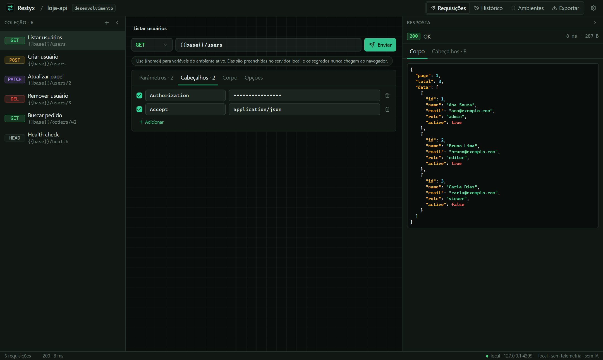
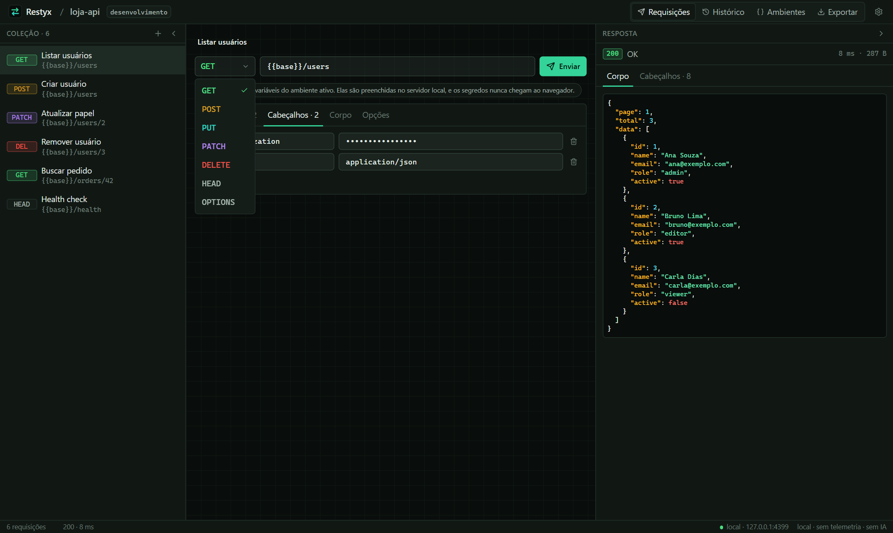
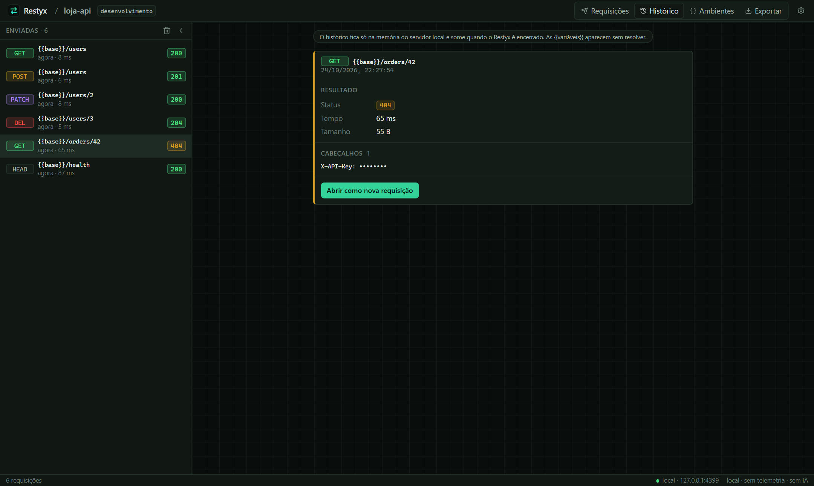
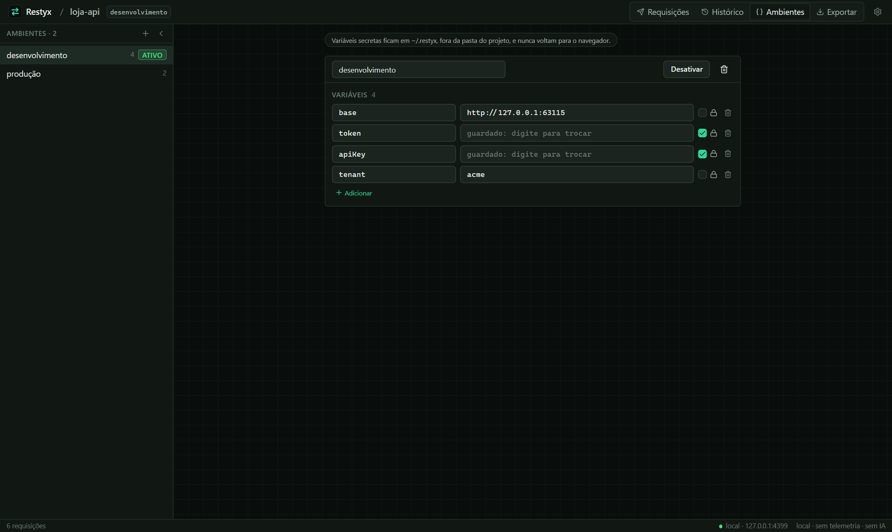
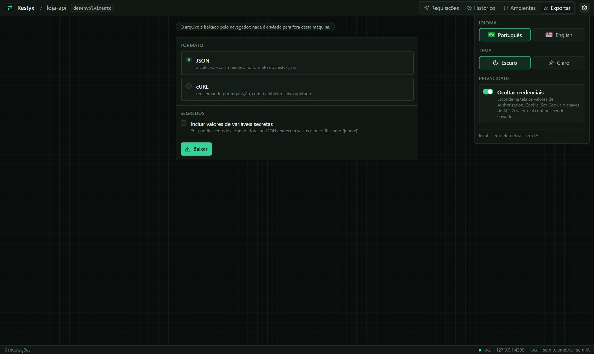
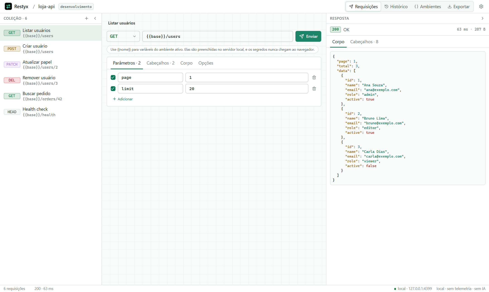
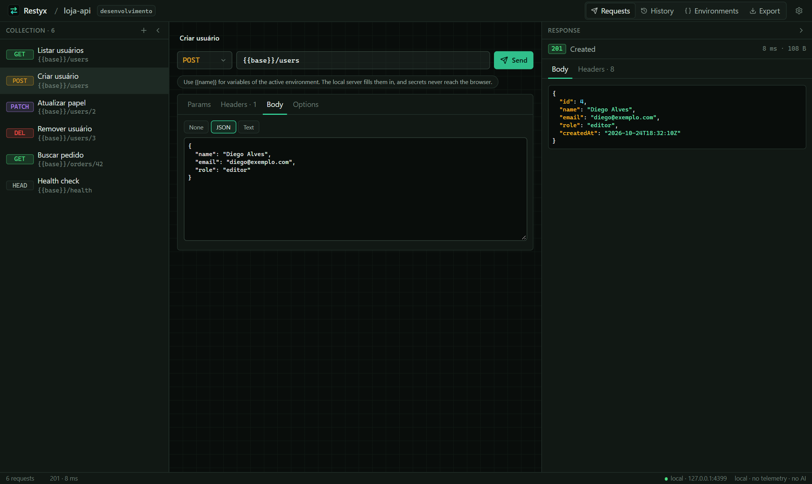

<p align="center">
  
</p>

<h1 align="center">Restyx</h1>

<p align="center">
  <b>English</b> · <a href="README.pt-BR.md">Português (Brasil)</a>
</p>

<p align="center">
  A REST API client in your browser: collections, environments with secrets, history and export. It runs on your machine, without accounts, telemetry or AI.
</p>

<p align="center">
  
  
  
  
  
  
  
</p>

<p align="center">
  
</p>

> [!NOTE]
> **Nothing leaves your machine except the requests you send.** The server listens on `127.0.0.1` only, the page needs a random token, and there is no telemetry, account, CDN or remote font.

## Features

- **Requests**: method, URL, params, headers and a JSON or text body, saved in a collection. The response shows status, time, size, headers and a highlighted body.
- **Environments**: `{{variables}}` filled in by the local server. **Secret** variables are stored outside the project and never go back to the browser.
- **History**: what you sent in this session, kept only in memory and erased when Restyx stops.
- **Export**: the collection as JSON or as cURL commands, with secrets left out unless you include them.
- **Settings**: English and Portuguese (Brazil), dark and light themes, and masking of credential headers on screen.

## Screenshots

**Method picker**: each method in its own color, in the theme of the page.

<p align="center"></p>

**History**: what was sent in this session, with status, time and size; credentials stay masked.

<p align="center"></p>

**Environments**: secret variables show only that a value is stored.

<p align="center"></p>

**Settings**: language, theme and privacy in one place.

<p align="center"></p>

**Light theme** and **English**:

<p align="center">
  
  
</p>

## Privacy and security

| What | How |
| --- | --- |
| Who can open the UI | Only `127.0.0.1`/`localhost`, with a random token exchanged for an `HttpOnly`, `SameSite=Strict` cookie |
| DNS rebinding and CSRF | Foreign `Host` → 421; foreign `Origin`, cross-site `Sec-Fetch-Site`, or a write without `Origin` → 403. Bodies are parsed only after these checks |
| The page itself | Strict CSP (`connect-src 'self'`, no inline script, no frames, no objects), `nosniff`, `no-referrer`, `no-store` on the API |
| Responses | Shown as text only, never rendered as HTML, so an API cannot run script inside Restyx |
| Secrets | Stored in `~/.restyx/secrets/<hash>.json` (mode `0600`), never in `.restyx.json`, never sent to the browser, history or export (unless you tick the box) |
| Redirects | Not followed by default; when followed (max 5), `Authorization`, `Proxy-Authorization` and `Cookie` are dropped on a change of origin |
| Requests | Only `http://` and `https://`; credentials in the URL are refused; TLS is always verified; 5-minute max timeout; response body capped at 10 MB; no cookie jar |
| Input | Everything from the browser and from `.restyx.json` is validated before use |

## Getting started

All you need is [Node.js](https://nodejs.org) **20.19 or newer**.

```sh
git clone https://github.com/SamuelSchutz13/Restyx.git
cd Restyx
npm install
npm run build
npm link          # makes the `restyx` command available everywhere
```

Then, in any folder:

```sh
restyx                          # starts the server and opens the browser
restyx --port 8080 --open=false
restyx ../another-project
```

The terminal prints a URL like `http://127.0.0.1:54321/?t=…`. Press **Ctrl+C** to stop.

The collection is saved in `.restyx.json` in that folder. It holds no secret values, so it can be committed and shared.

## Development

```sh
npm run dev:server   # API on 127.0.0.1:4317; open the printed URL once
npm run dev:web      # Vite with the /api proxy
npm test             # Jest: server and web
```
